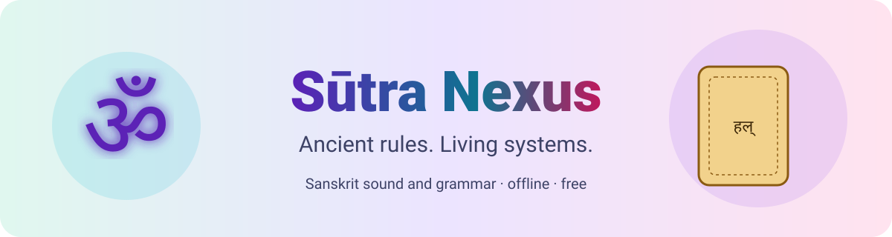

# Sūtra Nexus
**Ancient rules. Living systems.** A free, offline study app for Sanskrit sound and grammar, built from open data by a lifelong student and AI enthusiast.

    

## Live app and downloads
Live app: https://sutra-nexus.vercel.app/ (a static site, also works offline when you open `index.html` from a download).
Downloads: [cheat sheet](https://sutra-nexus.vercel.app/downloads/sutra-nexus-pratyahara-cheat-sheet.pdf), [sound chart](https://sutra-nexus.vercel.app/downloads/sutra-nexus-sound-and-sthana-chart.pdf), [sūtra type guide](https://sutra-nexus.vercel.app/downloads/sutra-nexus-sutra-type-guide.pdf), [Śiva Sūtras one-pager](https://sutra-nexus.vercel.app/downloads/sutra-nexus-shiva-sutras-one-pager.pdf), [slide deck](https://sutra-nexus.vercel.app/downloads/sutra-nexus-slide-deck.pptx), [single-file app](https://sutra-nexus.vercel.app/downloads/sutra-nexus-single-file.html).
Note: the PDFs, the slide deck and the screenshots are binary files. This repository was populated with a text-only tool, so those files are served from the live site and are not committed here. The text sources that generate the single file and the knowledge base are included.

## What it looks like
The app is bright and multicolour, with six themes (Aurora, Neon, Holographic, Cyberpunk Sunset, Light, High contrast) and an always-visible display control for text size, theme and reduced motion. Glowing 3D objects tied to the subject (a rotating om, a turning palm-leaf manuscript, an oil lamp, orbiting Devanāgarī letters) appear on the home room; phones and reduced-motion users get lighter versions. A glowing banner links every room, a wheel tab on the left opens the full menu, and a glowing footer holds three floating 3D badges.

 

## What is inside
- **Māheśvara sūtras:** the 14 lines and a pratyāhāra builder computed from them (checked against ac, ik, yaṇ, śar, ak, ec, hal and al).
- **Aṣṭādhyāyī browser:** 3,983 sūtras with search by number, Devanāgarī or IAST, filters, anuvṛtti and charts.
- **Śiva Sūtras:** 75 sūtras of the Kashmir text with numbering and source notes.
- **Sound lab, Practice, Ecosystem, Resources, Downloads, About.**
- **Nexus Monkey:** a guide bot with tours, quizzes, flashcards, a teach-me mode, daily challenge, badges and a one-hour path. Its knowledge base is generated by `guidebot/gen_kb.py` from the app's own content.
- 27 inline SVG diagrams, 15 animated flows, pastel cheat-sheet PDFs, a slide deck and a single-file copy of the app.

## Contents
| Path | What it is | Size |
|---|---|---|
| `index.html` | Entry file: open this in any browser | 1 KB |
| `css/nexus.css` | Six themes and layout | 22 KB |
| `js/core.js` | Display control, menu, footer, progress | 16 KB |
| `js/rooms.js` | The ten rooms | 38 KB |
| `js/diagrams.js` | 27 inline SVG diagrams | 16 KB |
| `js/data.js` | Compact copy of the three data files | 11 KB |
| `js/content.js` | Glossary, quiz bank, flashcards, tables | 85 KB |
| `guidebot/` | Guide bot module and generated knowledge base | 142 KB |
| `data/` | The three source JSON files | 2.6 MB |
| `downloads/sutra-nexus-pratyahara-cheat-sheet.pdf` | Pratyāhāra cheat sheet (PDF, A4, 2 pages) | 269 KB |
| `downloads/sutra-nexus-sound-and-sthana-chart.pdf` | Sound and sthāna chart (PDF, A4, 2 pages) | 294 KB |
| `downloads/sutra-nexus-sutra-type-guide.pdf` | Sūtra type guide (PDF, A4, 2 pages) | 286 KB |
| `downloads/sutra-nexus-shiva-sutras-one-pager.pdf` | Śiva Sūtras one-pager (PDF, A4, 1 page) | 257 KB |
| `downloads/sutra-nexus-slide-deck.pptx` | Slide deck (PowerPoint) | 67 KB |
| `downloads/sutra-nexus-single-file.html` | Single-file app (HTML) | 1.1 MB |
| `verify.py` | Checks counts, JSON, links, sizes, KB generation | 9 KB |
| `tools/` | Generator scripts for data, KB, PDFs, deck, single file | 64 KB |

Run `python3 verify.py` to check counts (3,983 / 14 / 75), JSON validity, that no external resources are loaded, file sizes and knowledge-base generation.

## Honesty notes
Every canon line carries a citation. The data files hold no English meanings, so lines say "meaning: UNKNOWN in source"; the few short bridge ideas are labelled as interpretations. The transliteration was converted by a script and has not been checked by a person. Śiva Sūtras numbering follows the source file (75); which sūtras differ from the 77 count of the other recension is UNKNOWN beyond the file's meta note.

## Licence
The application code (HTML, CSS, JavaScript and the Python build scripts) is released under the MIT licence, see `LICENSE`. That licence covers the app code only. The files in `data/` come from third-party open sources; their own notes say "Free to use with credit" or "ancient text public domain", with no formal SPDX licence. They keep their original terms and are not relicensed here. Credit and sources are listed in the data files' `meta` blocks.

## Disclaimer
Sūtra Nexus is an independent, free, learning-only student project. It respects every company, tradition and vendor; trademarks and sources belong to their owners. If something should be removed or corrected, it will be handled promptly via https://cyphermonkeylabs.com/#contact. Nothing here is sold, and I am happy to volunteer for any organization.

---

<b>Sūtra Nexus</b> · © 2026 CypherMonkeyLabs 
<a href="https://cyphermonkeylabs.com">CypherMonkey Labs</a> · <a href="https://github.com/CypherMonkeyLabs">GitHub organization</a> · <a href="https://github.com/cipher0x9">GitHub</a> · <a href="https://x.com/Cypher0x9">X</a> · <a href="https://www.linkedin.com/in/luckylakshmanucwebex">LinkedIn</a> · <a href="https://huggingface.co/Cypher0x9">Hugging Face</a>

